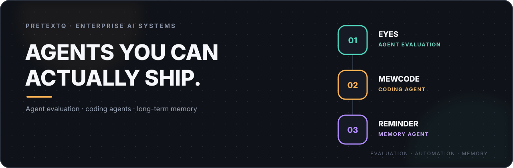

<p align="center">
  
</p>

<p align="center">
  <a href="./README.md">简体中文</a>
  ·
  <a href="./README.zh-TW.md">繁體中文</a>
  ·
  <strong>English</strong>
</p>

<h1 align="center">Hi, I'm pretextQ 👋</h1>

<h3 align="center">I don't build chat demos — I build permission-controlled, verifiable systems that ship to enterprise production.</h3>

<p align="center">
  Agent Evaluation & Observation · Coding Agent & Alert Automation · Long-term Memory & Knowledge Workspace · DevOps Engineering
</p>

<p align="center">
  <a href="https://github.com/pretextQ">GitHub</a>
</p>

---

## Three repos: agent evaluation, execution and long-term memory

I treat "can it ship to enterprise production" as the first metric of any system: the model is just the reasoning component — what actually decides success is the permission boundary, tool and context governance, verification tooling and observability.

These three projects focus on agent execution evaluation, automated fixes and long-term memory:

<table>
  <tr>
    <td width="33%" valign="top">
      <strong>👁️ Agent Evaluation / Observation</strong><br/><br/>
      Evaluate agents with external datasets and custom scoring, connecting traces and evidence to versioned regression reports.
    </td>
    <td width="33%" valign="top">
      <strong>🧩 Coding Agent</strong><br/><br/>
      How an AI coding agent turns production alerts into reviewable fix PRs unattended: OS-level sandbox, read-only toolchain, structured evidence chains and bounded retries.
    </td>
    <td width="33%" valign="top">
      <strong>🧠 Memory / Knowledge</strong><br/><br/>
      Build lasting memory from notes and documents with hybrid retrieval, memory governance and verifiable citations.
    </td>
  </tr>
</table>

```text
eyes                    →  agent evaluation, execution observation and regression evidence
MewCode                 →  alerts in, PRs out: unattended fixes in an OS sandbox
Reminder                →  long-term memory, hybrid retrieval and traceable knowledge
```

---

## 01 / eyes

### [Agent evaluation and execution observation](https://github.com/pretextQ/eyes)

> Evaluate agent changes with external datasets, custom scoring and execution evidence.

| Form | Focus | Status | Links |
|---|---|---|---|
| Self-hosted agent evaluation and observation platform | Concurrent experiments · scoring · traces · regression reports | v0.1.0 · agreed scope delivered; on-demand use and maintenance | [Repository](https://github.com/pretextQ/eyes) |

eyes connects versioned experiments to execution attempts, scores, traces and artifacts. It supports HTTP/Python integration, multi-agent batches and passive observation of local agent sessions.

### From execution to regression evidence

```text
Agent + JSONL dataset + custom scorer
      ↓
Control backend / scheduler ── versions · concurrency limits
      ↓
Independent Runner ── attempts · traces · artifacts
      ↓
Scoring process ── decisions · reasons · evidence references
      ↓
Web / CLI / API ── regression reports · CI gates
```

- **Traceable scores**: link decisions to attempts, scoring rules and evidence.
- **Visible observation gaps**: show collected calls and relationships alongside missing evidence.
- **Comparable regressions**: pin configurations and flag dataset or scoring changes.
- **Separate scoring**: independent execution and scoring, with cancellation, retries and retention controls.
- **Real integrations and operations**: recorded MewCode Python/unified HTTP and independent trae HTTP runs, dual-agent concurrency and targeted recovery; trae passive observation, offline replay, lifecycle, capacity alerts and cancellation audits passed their agreed scopes.
- **Security and resource hardening**: October 22 fixes cover secret references, explicit opt-in for remote cleartext control, cancellation dispatch races, event/detail limits, evidence restoration and local retention. Static checks, offline migration SQL, wheel and Web builds passed; real concurrency, cancellation, quota and recovery checks still need runtime verification for this round. See the [maintenance record](https://github.com/pretextQ/eyes/blob/main/docs/Review/2026-10-22-remediation.md).
- **Explicit validation scope**: intended for one self-hosted team and on-demand use. Full fault matrices, long-term capacity and real-version improvements/regressions remain unaccepted. The first coding round passed two tasks and failed the order task; its later retry ended unknown without a valid quality score. See the [real evaluation record](https://github.com/pretextQ/eyes/blob/main/docs/coding-regression-real-acceptance-20261016.md).

**Core Stack**

`Python 3.14` `FastAPI` `SQLAlchemy` `PostgreSQL` `OpenTelemetry` `React` `TypeScript` `Vite`

---

## 02 / MewCode

### [An AI Coding Agent that turns alerts into reviewed PRs](https://github.com/pretextQ/MewCode)

> One Agent core for an interactive CLI/TUI and an alert-driven service: investigate, fix and verify in a sandbox, then hand the PR to a human.

| Form | Focus | Trust boundary | Links |
|---|---|---|---|
| AI Coding Agent + alert-driven dev service | Alert → fix PR · OS-level sandbox · bounded retries | Human review is the only gate · no merge permission | [Repository](https://github.com/pretextQ/MewCode) |

### The unattended path from alert to PR

```text
Alert (Alertmanager webhook)
      ↓
Service layer ── SQLite state machine · fingerprint dedup · restart recovery
      ↓
Isolated unit per job (git worktree + Docker sandbox)
      ↓
Agent core ── locate · fix · bounded retries (escalate on limit)
      ↓
Verification ── regression tests + self-started docker-compose integration tests
      ↓
PR + CI gate ─▶ human review (the only release gate)
```

- **Isolation and permissions**: independent worktrees, Docker sandboxes and read-only MCP tools enforce resource and permission boundaries.
- **Bounded repairs**: investigation, fixes, regression and integration tests form one workflow; exhausted retries escalate to a human, with root-cause and test evidence in the PR.
- **Reliable operations**: alert deduplication, restart recovery, notification Outbox and policy revalidation, with metrics and token usage for job reports.
- **Extensions and review**: Skill/MCP support and Windows compatibility; independent review and supervision are off by default, providing advice and feedback within existing budgets.
- **Evidence and limits**: [real demo PRs](https://github.com/pretextQ/mewcode-alert-demo/pull/5) and [verification records](https://github.com/pretextQ/MewCode/blob/master/docs/stage-2026-11-01-dead-end.md) are available. Production benefits remain unproven; fine-grained egress restrictions require host configuration.

Details: [Service reliability](https://github.com/pretextQ/MewCode/blob/master/guides/service-reliability.md) · [Independent review](https://github.com/pretextQ/MewCode/blob/master/guides/independent-review.md) · [Supervision](https://github.com/pretextQ/MewCode/blob/master/guides/supervision.md)

**Core Stack**

`Python 3.11` `Textual` `asyncio` `Docker sandbox` `MCP` `Prometheus` `SQLite` `GitHub Actions`

---

## 03 / Reminder

### [The memory Agent at the heart of Mneme](https://github.com/pretextQ/Reminder)

> Turn notes, documents and experiences into searchable, traceable personal memory.

| Form | Focus | Status | Links |
|---|---|---|---|
| Mneme memory agent and knowledge workspace | Retrieval · memory governance · citations · recovery | v0.1.0 · online answers routed through Reminder API | [Repository](https://github.com/pretextQ/Reminder) |

Reminder handles retrieval, memory governance, answers and citation verification. Mneme supplies the workspace, knowledge graph, profiles and growth analysis. Separate databases and versioned HTTP contracts define their ownership boundaries.

### Memory with evidence and clear boundaries

```text
Vue workspace → Mneme API
      ↓
Reminder API → BGE-M3 + PostgreSQL / pgvector
      ↓
Memory governance · answers · citation verification
      ↓
Durable Agent Run · Outbox / Inbox · rebuildable projections
```

- **Grounded retrieval**: combine vectors, keywords and graph information with answer evidence; added normalized backend-score fusion and optional BGE-M3 sparse document retrieval, retaining dense + keyword retrieval until sparse backfill is complete.
- **Knowledge MCP connectors**: read-only listing, search and source retrieval for a configured Feishu wiki and Confluence Cloud space. See the [Feishu guide](https://github.com/pretextQ/Reminder/blob/master/docs/feishu-wiki-mcp.md) and [Confluence guide](https://github.com/pretextQ/Reminder/blob/master/docs/confluence-mcp.md).
- **Governed memory**: candidates, human review, revisions and evidence relationships.
- **Recoverable runs**: durable records, leases and idempotency support retries and interruptions.
- **Deletion boundaries**: deletion fences prevent stale events from restoring removed data.
- **Delivery workflow**: workspace, Compose services, versioned GHCR images and CI evaluations.

**Core Stack**

`Python 3.12` `FastAPI` `Vue 3` `TypeScript` `PostgreSQL / pgvector` `BGE-M3` `Neo4j` `Redis / Celery` `Docker Compose`

---

## The method behind the three projects

| Principle | How I engineer |
|---|---|
| **Permissions first** | Agent tools follow permission layers and read-only boundaries; fixes run in sandboxes and PRs receive human review. |
| **Evidence before answers** | Answers need grounding, assertions need data, findings need evidence — no conclusions that cannot be traced back. |
| **Thin core, replaceable parts** | The agent core and testing are organized around a thin core; implementations are pluggable components. |
| **Observable and auditable** | Runtime metrics, job reports, scoring evidence and citation audits come before feature piling — behavior can be replayed and measured. |
| **Everything into CI** | Evaluation replays, pytest + ruff + mypy checks and containerized runs all live in GitHub Actions; docs evolve with code. |

## Tech landscape

| Layer | Technologies | What I build |
|---|---|---|
| **Agent Evaluation & Web** | Python, FastAPI, SQLAlchemy, PostgreSQL, OpenTelemetry, React, TypeScript | Control plane, independent Runner, traces, scoring and regression reports |
| **Agent Internals** | Textual, asyncio, MCP, Docker, Prometheus | Agent loop, permission layering, sandboxed execution, alert-driven service mode |
| **Memory & Knowledge** | Vue, FastAPI, PostgreSQL / pgvector, BGE-M3, Neo4j, Redis / Celery | Long-term memory, knowledge workspace, graph projections and recoverable workflows |
| **Testing & Quality** | Pytest, ruff, mypy, TypeScript | Agent evaluations, regression verification, static typing and lint checks |
| **Delivery & Ops** | Docker, Docker Compose, GitHub Actions, GHCR, Prometheus | CI, orchestration, versioned images, monitoring and operations |

---

<h3 align="center">Agents you can actually ship.</h3>

<p align="center">
  If you are also working on enterprise agents, coding agent internals, agent evaluation or long-term memory systems — let's talk.
</p>

<p align="center">
  <a href="https://github.com/pretextQ">Explore my repositories</a>
</p>
