# pretextQ

构建可验证、可观测、权限可控的 Agent 系统。

<strong>简体中文</strong> · <a href="./README.zh-TW.md">繁體中文</a> · <a href="./README.en.md">English</a>

## 精选项目

<table width="100%">
<tr><td width="9999">
<h3><picture><source media="(max-width: 600px)" srcset="./assets/flow-spacer.svg" /></picture> <a href="https://github.com/pretextQ/eyes">eyes</a></h3>

<strong>Agent 评测与执行观测</strong> 
自托管评测与观测，让 Agent 修改有评分、有证据。 
v0.1.0 · Python / FastAPI / React / PostgreSQL 
<a href="https://github.com/pretextQ/eyes">仓库</a> · <a href="https://github.com/pretextQ/eyes#两条使用路径">接入与使用</a>

</td></tr>
</table>

<table width="100%">
<tr><td width="9999">
<h3><picture><source media="(max-width: 600px)" srcset="./assets/flow-spacer.svg" /></picture> <a href="https://github.com/pretextQ/MewCode">MewCode</a></h3>

<strong>从线上告警到可审查的修复 PR</strong> 
在沙箱中修复、验证，以 PR 交给人工；服务无合并权限。 
v0.3.0 · Python / Textual / Docker / SQLite 
<a href="https://github.com/pretextQ/MewCode">仓库</a> · <a href="https://github.com/pretextQ/mewcode-alert-demo/pull/5">真实修复 PR</a>

</td></tr>
</table>

<table width="100%">
<tr><td width="9999">
<h3><picture><source media="(max-width: 600px)" srcset="./assets/flow-spacer.svg" /></picture> <a href="https://github.com/pretextQ/Reminder">Reminder</a></h3>

<strong>有来源、可治理的长期记忆</strong> 
为 Mneme 知识工作台提供可检索、可追溯的个人记忆。 
v0.1.0 · Python / FastAPI / Vue / pgvector / BGE-M3 
<a href="https://github.com/pretextQ/Reminder">仓库</a> · <a href="https://github.com/pretextQ/Reminder/blob/master/docs/architecture.md">架构与边界</a>

</td></tr>
</table>

## 近期进展

- **2026-11-01 · MewCode** — 已交付通知 Outbox、策略恢复重验证与重复 pytest 失败反馈；独立审查与监督默认关闭，模型效果与生产收益仍待验证。[交付记录](https://github.com/pretextQ/MewCode/blob/master/docs/README.md)

- **2026-10-22 · eyes** — 完成安全与资源边界修复，静态与构建检查通过，新增运行验收仍待复验；体验改进保留在待办中。[维护记录](https://github.com/pretextQ/eyes/blob/main/docs/Review/2026-10-22-remediation.md) · [设计待办](https://github.com/pretextQ/eyes/blob/main/docs/TODO.md)

- **Reminder · 按需维护** — 已有混合分数融合、可选 BGE-M3 sparse 检索与飞书 / Confluence 只读 MCP 接入。[飞书](https://github.com/pretextQ/Reminder/blob/master/docs/feishu-wiki-mcp.md) · [Confluence](https://github.com/pretextQ/Reminder/blob/master/docs/confluence-mcp.md)

## 技术方向

Agent Runtime · Evaluation & Observability · Memory & Retrieval · Infrastructure

关注权限边界、有界执行和可追溯证据。把实现、真实验证与待办分别记录。

---

状态核对：2026-11-01（Asia/Shanghai） · eyes c94d500 / MewCode cc98162 / Reminder 9f1d5e8
