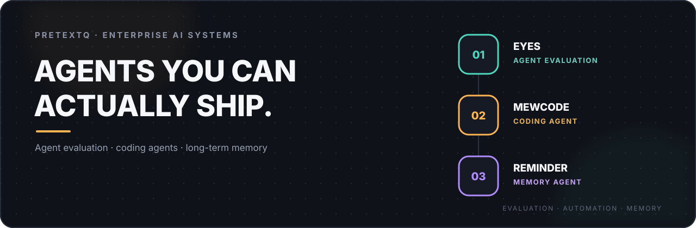

<p align="center">
  
</p>

<p align="center">
  <a href="./README.md">简体中文</a>
  ·
  <strong>繁體中文</strong>
  ·
  <a href="./README.en.md">English</a>
</p>

<h1 align="center">你好，我是 pretextQ 👋</h1>

<h3 align="center">我建構的不是「會跑的 Demo」，而是權限可控、結果可驗證、能落進企業生產環境的系統。</h3>

<p align="center">
  Agent 評估與執行觀測 · Coding Agent 與告警自動化 · 長期記憶與知識工作台 · DevOps 工程化
</p>

<p align="center">
  <a href="https://github.com/pretextQ">GitHub</a>
</p>

---

## 三個儲存庫，涵蓋 Agent 評估、執行與長期記憶

我習慣把「能不能落進企業生產環境」當作系統的第一指標：模型只是其中的判斷元件，真正決定成敗的，是權限邊界、工具與上下文治理、驗證手段和可觀測性。

這三個專案分別聚焦 Agent 執行評估、自動修復與長期記憶：

<table>
  <tr>
    <td width="33%" valign="top">
      <strong>👁️ Agent Evaluation / Observation</strong><br/><br/>
      用外部測試集與自訂評分驗證 Agent，關聯執行軌跡、評分證據與版本迴歸報告。
    </td>
    <td width="33%" valign="top">
      <strong>🧩 Coding Agent</strong><br/><br/>
      AI Coding Agent 如何無人值守地把線上告警變成可人審的修復 PR：OS 級沙箱、唯讀工具鏈、結構化證據鏈與有界重試。
    </td>
    <td width="33%" valign="top">
      <strong>🧠 Memory / Knowledge</strong><br/><br/>
      將筆記、文件與經歷沉澱為長期記憶，透過混合檢索、記憶治理與引用驗證保留回答依據。
    </td>
  </tr>
</table>

```text
eyes                    →  Agent 測試、執行觀測與有證據的迴歸比較
MewCode                 →  告警進來、PR 出去：沙箱裡的無人值守修復
Reminder                →  長期記憶、混合檢索與可追溯的知識工作台
```

---

## 01 / eyes

### [Agent evaluation and execution observation](https://github.com/pretextQ/eyes)

> 用外部測試集、自訂評分與執行證據，驗證 Agent 修改是否有效，並看清每次任務如何執行。

| 專案形態 | 核心定位 | 目前狀態 | Links |
|---|---|---|---|
| 自託管 Agent 測試與執行觀測平台 | 並行實驗 · 自訂評分 · 執行證據 · 迴歸比較 | v0.1.0 · 目前約定範圍已交付，按需使用與維護 | [Repository](https://github.com/pretextQ/eyes) |

eyes 將目標 Agent、測試集版本、評分器版本和執行設定綁定到實驗，關聯用例執行、評分紀錄、軌跡與產物。支援 HTTP/Python 接入、獨立評分程序、多 Agent 批次和持久化迴歸報告，也可透過 SDK 直接觀測本地 Agent 對話，無需先建立實驗。

### 從執行過程到迴歸證據

```text
目標 Agent + JSONL 測試集 + 自訂評分器
      ↓
控制後端與排程器 ── 固定版本 · 並行限制
      ↓
獨立 Runner ── 執行嘗試 · 軌跡 · 產物
      ↓
獨立評分程序 ── 判定 · 理由 · 證據引用
      ↓
Web / CLI / API ── 迴歸報告 · CI 品質門檻
```

- **評分可追溯**：結論關聯用例、執行嘗試、評分口徑和實際證據，區分執行失敗、評分失敗與證據不足。
- **執行過程可觀測**：展示已採集的模型呼叫、工具執行和呼叫關係，明確採集覆蓋範圍與缺失狀態。
- **迴歸口徑明確**：固定實驗設定，按用例版本比較改善與退化，單獨標記測試集或評分口徑變化帶來的不可比項。
- **執行與評分分離**：獨立 Runner 和評分程序，支援評分取消、重試及證據保留清理。
- **真實接入與維運驗收**：MewCode Python/統一 HTTP、獨立 trae HTTP、雙 Agent 並行與定向恢復已有紀錄；trae 被動觀測、離線補傳、生命週期、容量告警與取消稽核通過各自約定範圍。
- **安全與資源邊界強化**：10 月 22 日完成金鑰引用校驗、遠端明文控制連線明確授權、取消派發競態、事件與詳情上限、證據恢復及本地保留清理等修復。靜態檢查、離線遷移 SQL、wheel 與 Web 建置通過；本輪真實並行、取消、配額與恢復仍待執行複驗，見[維護紀錄](https://github.com/pretextQ/eyes/blob/main/docs/Review/2026-10-22-remediation.md)。
- **驗證邊界透明**：目前面向單團隊自託管、按需執行；完整故障矩陣、長期容量與真實版本改善/退化尚未驗收。編碼專項首輪兩題通過、訂單題失敗，後續重試為 unknown，無有效品質評分，見[真實評測紀錄](https://github.com/pretextQ/eyes/blob/main/docs/coding-regression-real-acceptance-20261016.md)。

**Core Stack**

`Python 3.14` `FastAPI` `SQLAlchemy` `PostgreSQL` `OpenTelemetry` `React` `TypeScript` `Vite`

---

## 02 / MewCode

### [An AI Coding Agent that turns alerts into reviewed PRs](https://github.com/pretextQ/MewCode)

> 同一個 agent 核心，兩種形態：互動式 CLI/TUI 幫你寫程式碼；無頭服務常駐接線上告警——agent 在 OS 級沙箱裡定位、修復、驗證，以 PR 交給人工 review。人審 PR 是唯一必經的人工節點，服務沒有任何 merge 權限。

| 專案形態 | 核心定位 | 信任邊界 | Links |
|---|---|---|---|
| AI Coding Agent + 告警驅動的自動化開發服務 | 告警 → 修復 PR · OS 級沙箱 · 有界重試 | 人審 PR 唯一關卡 · 服務無 merge 權限 | [Repository](https://github.com/pretextQ/MewCode) |

MewCode 把「收到告警 → 定位 → 修復 → 驗證 → 提交 review」這條值班鏈路自動化：Alertmanager webhook 觸發，每個 job 在獨立沙箱與 git worktree 中執行，PR body 自帶結構化證據鏈——告警摘要、根因、測試前後對比、整合驗證——審查者不看 agent 日誌也能做判斷。2026-10-05 的三類 demo bug、前後兩輪共 6 單全部無人值守跑通，每輪告警→PR 中位數 25–26 秒；這是小樣本重放結果，非生產成功率承諾。

### 從告警到 PR 的無人值守鏈路

```text
告警（Alertmanager webhook）
      ↓
服務層 ── SQLite 狀態機 · 指紋去重 · 重啟恢復
      ↓
每 job 隔離單元（git worktree + Docker 沙箱）
      ↓
Agent 核心 ── 定位 · 修復 · 有界重試（超限 escalate）
      ↓
驗證 ── 迴歸測試 + 自起 docker-compose 整合測試
      ↓
PR + CI 關卡 ─▶ 人工 review（唯一上線關卡）
```

- **告警進來，PR 出去**：demo 儲存庫保留歷次無人值守執行的真實 PR，每份都是完整證據鏈，可從 [PR #5](https://github.com/pretextQ/mewcode-alert-demo/pull/5) 看起。
- **修不好就誠實升級**：重試有上限，超限進入 escalate 並附上已嘗試的分析；驗證不過的修復不會被發布，絕不產生垃圾 PR。
- **OS 級沙箱**：agent 在容器內執行——非 root、全部能力丟棄、唯讀根檔案系統、CPU/記憶體/PID 限制、硬逾時強制終止，宿主設定與金鑰不進容器。
- **內部工具鏈唯讀**：內建生產日誌（Loki）與 CI 狀態（GitHub）兩個 MCP server，讀取路徑只有 GET；未聲明 readOnlyHint 的工具在服務模式一律不掛。
- **自起測試環境**：儲存庫帶 docker-compose.yml 時自動啟動依賴，在沙箱內跑整合測試；無容器執行環境則如實記錄「未執行」，不用假驗證充數。
- **營運可量化**：/metrics（Prometheus）、單 job JSON 複盤、按儲存庫 token 成本；評估集回放讓每次提示詞/核心改動都有成功率、MTTR 與成本的前後對比。
- **多儲存庫策略**：`.mewcode/policy.yaml` 聲明觸發路由、目標分支、token 預算與通知管道，按 job 即時讀取、改檔案即生效，損壞的策略快速失敗而非靜默回退。
- **互動式核心同樣完整**：工具集 + 權限分層管線（deny 優先於白名單）+ Skill 與 MCP 擴充，Windows 是一等公民平台。
- **人工審查閉環**：經身分驗證的決策介面記錄合併、要求修改或升級；修改意見重新入列，等待審查且已有 PR 的任務繼續合併重複告警，服務不執行遠端合併。
- **v0.3.0 維護驗證**：10 月 24 日修復涵蓋權限、恢復、上下文、資源清理與 CI 關卡；紀錄中的 pytest 為 1363 passed / 18 skipped，Windows/Linux 四組 CI 通過。本輪真實 Docker 隔離與模型執行未進行，見[維護交接](https://github.com/pretextQ/MewCode/blob/master/guides/maintenance.md)。
- **服務邊界持續強化**：維運與任務端點驗證身分、告警原子去重、取消時清理程序樹與容器、按 job 隔離測試環境，以及跨重試累計 token 預算。細粒度 egress 白名單仍需宿主網路層設定，見[信任模型](https://github.com/pretextQ/MewCode#信任模型无人值守为什么可信)。

### 這個專案真正要解決的問題

無人值守寫程式碼最難的不是「修得快」，而是「憑什麼信」：權限怎麼收斂、行為怎麼隔離、證據怎麼沉澱、改壞了怎麼保證不上線。MewCode 把信任當成設計起點——headless 模式下「要問人」的動作一律拒絕而非放行，PR 是唯一出口，人是唯一關卡。

**Core Stack**

`Python 3.11` `Textual` `asyncio` `Docker 沙箱` `MCP` `Prometheus` `SQLite` `GitHub Actions`

---

## 03 / Reminder

### [The memory Agent at the heart of Mneme](https://github.com/pretextQ/Reminder)

> 將筆記、文件與經歷沉澱為可檢索、可追溯、可持續演化的個人記憶。

| 專案形態 | 核心定位 | 目前狀態 | Links |
|---|---|---|---|
| Mneme 記憶 Agent 與知識工作台 | 混合檢索 · 記憶治理 · 引用驗證 · 可恢復執行 | v0.1.0 · 線上回答統一經過 Reminder API | [Repository](https://github.com/pretextQ/Reminder) |

Reminder 負責檢索、記憶治理、回答生成與引用驗證；Mneme 提供知識庫、文件工作台、知識圖譜、個人畫像和成長分析。兩者擁有獨立資料庫，透過版本化 HTTP 契約通訊，明確資料所有權與服務邊界。

### 讓長期記憶有來源、有邊界

```text
Vue 知識工作台 → Mneme API
      ↓
Reminder API → BGE-M3 + PostgreSQL / pgvector
      ↓
記憶治理 · 回答生成 · 引用驗證
      ↓
耐久 Agent Run · Outbox / Inbox · 可重建投影
```

- **混合檢索與證據引用**：融合語義向量、關鍵字與圖譜資訊，新增正規化後端分數融合與可選 BGE-M3 sparse 文件檢索；稀疏向量未補齊時繼續走 dense + keyword 路徑。
- **知識庫 MCP 接入**：新增指定飛書知識庫與 Confluence Cloud 空間的唯讀目錄、搜尋及原文讀取，見[飛書說明](https://github.com/pretextQ/Reminder/blob/master/docs/feishu-wiki-mcp.md)與[Confluence 說明](https://github.com/pretextQ/Reminder/blob/master/docs/confluence-mcp.md)。
- **記憶治理**：候選、人工治理、修訂歷史和證據關係共同維護長期記憶。
- **可恢復執行**：耐久執行紀錄、租約和冪等語義處理重試及程序中斷。
- **刪除與重建**：刪除 fence 防止舊事件恢復已刪資料，衍生狀態支援安全回填。
- **交付閉環**：Vue 工作台、Compose 服務棧、GHCR 版本映像與 CI 評測一起維護。

**Core Stack**

`Python 3.12` `FastAPI` `Vue 3` `TypeScript` `PostgreSQL / pgvector` `BGE-M3` `Neo4j` `Redis / Celery` `Docker Compose`

---

## 貫穿三個專案的工程原則

| 原則 | 我的工程取向 |
|---|---|
| **權限先行** | Agent 工具遵循權限分層與唯讀邊界，修復在沙箱內執行，PR 經人工審查。 |
| **Evidence before answers** | 回答要有依據、斷言要有資料、發現要有證據，不輸出無法回溯的結論。 |
| **薄核心，可替換** | Agent 核心與測試都以薄核心組織，具體實作做成可插拔元件。 |
| **可觀測與可稽核** | 執行指標、任務複盤、評分證據與引用稽核先於功能堆疊，行為可重放、可統計。 |
| **一切進 CI** | 評估集重放、pytest + ruff + mypy 檢查、容器化執行都進 GitHub Actions，文件與程式碼同步演進。 |

## 技術分層

| Layer | Technologies | What I build |
|---|---|---|
| **Agent Evaluation & Web** | Python, FastAPI, SQLAlchemy, PostgreSQL, OpenTelemetry, React, TypeScript | 服務控制面、獨立 Runner、執行軌跡、評分與迴歸報告 |
| **Agent Internals** | Textual, asyncio, MCP, Docker, Prometheus | Agent 核心、權限分層、沙箱執行與告警服務化 |
| **Memory & Knowledge** | Vue, FastAPI, PostgreSQL / pgvector, BGE-M3, Neo4j, Redis / Celery | 長期記憶、知識工作台、圖譜投影與可恢復非同步執行 |
| **Testing & Quality** | Pytest, ruff, mypy, TypeScript | Agent 評測、迴歸驗證、靜態型別與風格檢查 |
| **Delivery & Ops** | Docker, Docker Compose, GitHub Actions, GHCR, Prometheus | CI、環境編排、版本映像、監控與維運 |

## 最近在做的事

狀態核對：2026-10-25，依據三個專案的預設分支、README 與專項驗證紀錄。

- eyes：完成安全與資源邊界修復；下一步按[設計優化待辦](https://github.com/pretextQ/eyes/blob/main/docs/TODO.md)核對狀態表達、雙路徑引導、審閱工作區和流程圖體驗，計畫不計為已實作
- MewCode：v0.3.0 完成審查修復與相依項維護；[獨立修復審查、diff 覆蓋紀錄和 GitHub 評審回饋](https://github.com/pretextQ/MewCode/blob/master/docs/evolution/05-pr-review-improvements.md)仍為待實施計畫
- Reminder：推進混合檢索分數融合、BGE-M3 sparse 檢索與飛書 / Confluence 唯讀 MCP 接入

---

<h3 align="center">Agents you can actually ship.</h3>

<p align="center">
  如果你也在做企業 Agent 落地、Coding Agent 原理實作、Agent 評估或長期記憶系統，歡迎交流。
</p>

<p align="center">
  <a href="https://github.com/pretextQ">Explore my repositories</a>
</p>
